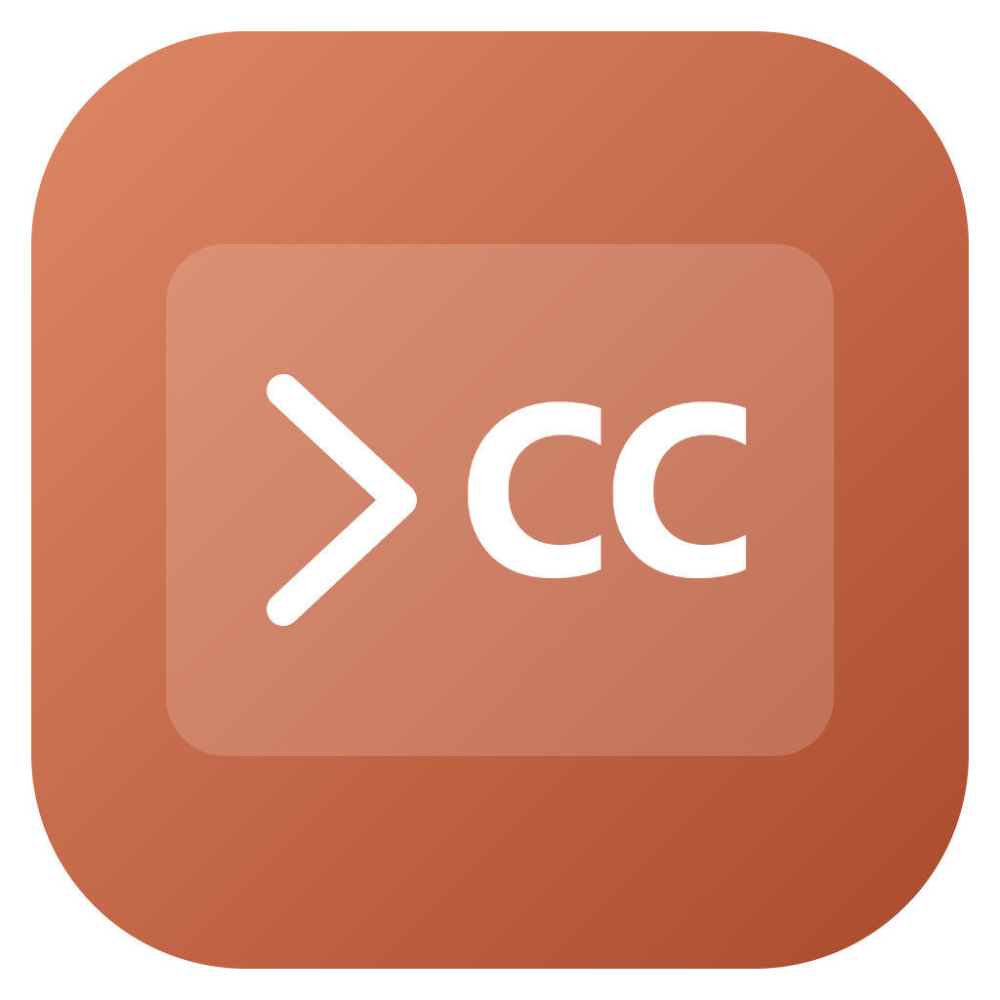
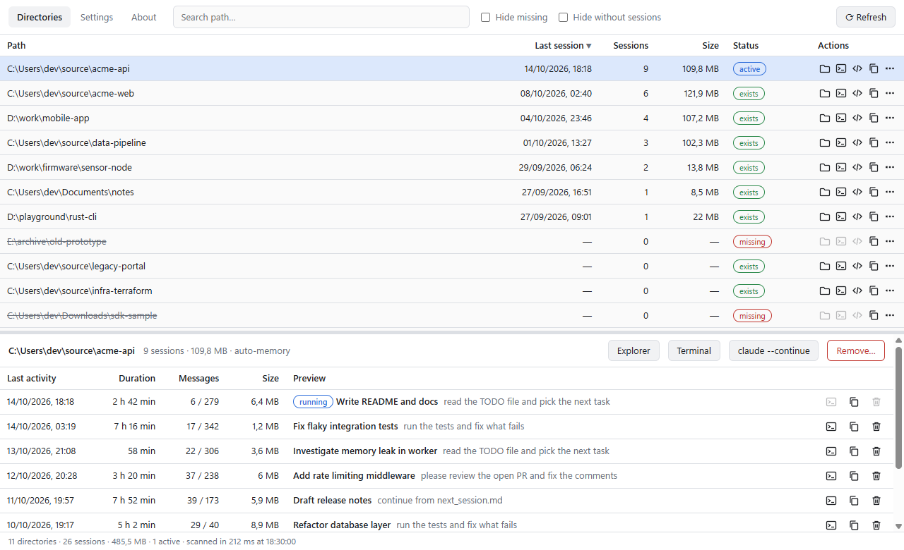
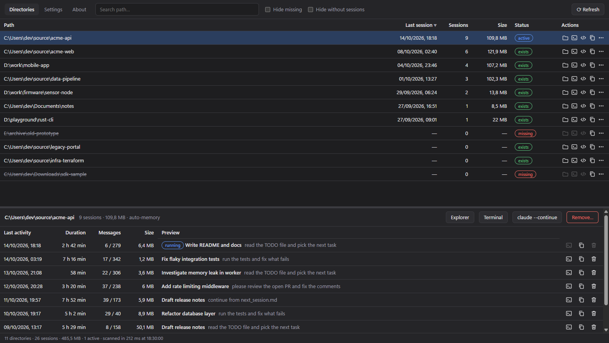
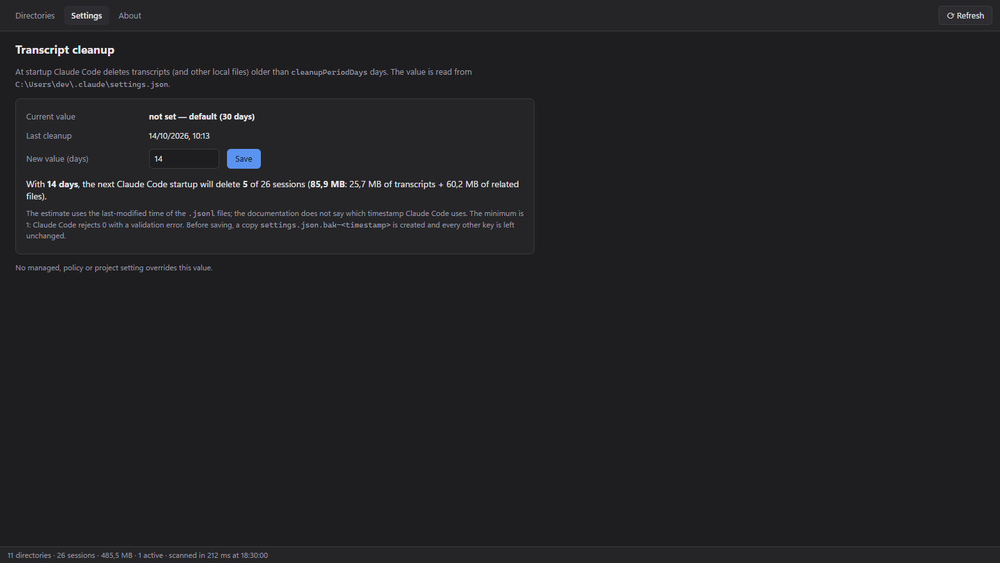
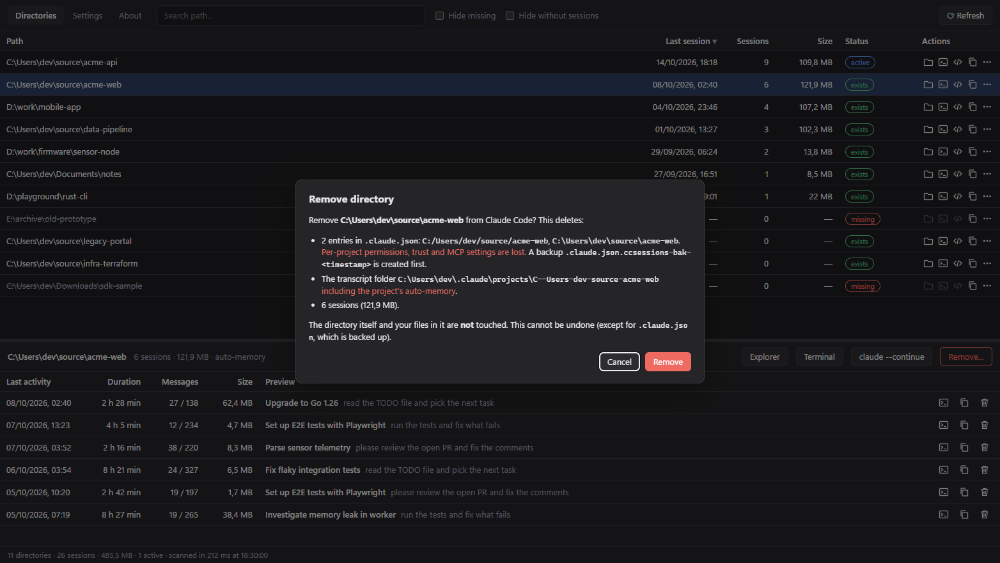
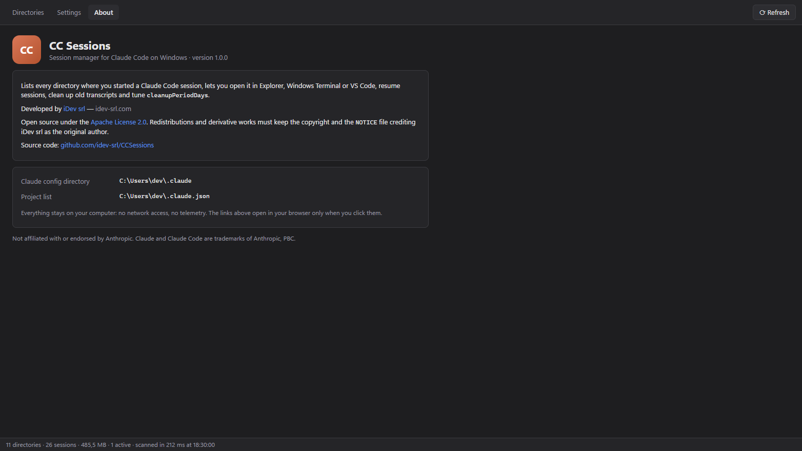

<div align="center">



# CC Sessions

**Find, open, resume and clean up your Claude Code sessions on Windows.**

A tiny, fast desktop app that lists every directory where you ran
[Claude Code](https://code.claude.com/docs), shows its sessions and lets you jump back in with one click.

[](https://github.com/idev-srl/CCSessions/releases/latest)
[](https://github.com/idev-srl/CCSessions/actions/workflows/ci.yml)
[](LICENSE)


[**Download**](https://github.com/idev-srl/CCSessions/releases/latest) ·
[Features](#-features) ·
[How it works](#-how-it-works) ·
[Build](#-build-from-source) ·
[FAQ](#-faq)

<br>



</div>

---

## ✨ Features

| | |
| --- | --- |
| 📂 **Every project in one place** | All directories where Claude Code was started, merged from `~/.claude.json` and the transcripts on disk, including those whose transcripts were already cleaned up. |
| 🔎 **Session details** | Last activity, duration, user/assistant messages, size, the AI-generated title and the first prompt of every session. |
| 🚀 **One-click actions** | Open in **File Explorer** (or double-click), **Windows Terminal** (PowerShell fallback) or **VS Code**; start `claude --continue`, `claude --resume` or resume a specific session. |
| 🟢 **Live sessions** | A *running* badge marks sessions owned by a live Claude Code process, which are protected from deletion. |
| 🗑️ **Clean up safely** | Delete single sessions or remove a whole directory from Claude Code, always after a confirmation that lists exactly what will be deleted. |
| 🧹 **Cleanup period** | Edit `cleanupPeriodDays` and preview how many sessions (and MB) the next cleanup will delete. Warns about managed, policy and project settings that override it. |
| ⚡ **Fast** | Parallel, streaming scan with caching: hundreds of sessions in a few hundred ms, refreshes in milliseconds. |
| 🌗 **Native feel** | Light and dark theme following Windows, keyboard shortcuts, a single portable `.exe`. |
| 🔒 **Private** | 100 % local: no network access, no telemetry, no background service, no installer. |

<table>
  <tr>
    <td></td>
    <td></td>
  </tr>
  <tr>
    <td align="center"><sub>Dark theme</sub></td>
    <td align="center"><sub>Cleanup period with preview</sub></td>
  </tr>
  <tr>
    <td></td>
    <td></td>
  </tr>
  <tr>
    <td align="center"><sub>Every deletion is confirmed</sub></td>
    <td align="center"><sub>About &amp; license</sub></td>
  </tr>
</table>

<sub>Screenshots use demo data.</sub>

## 📥 Download

1. Grab `ccsessions-<version>-windows-amd64.exe` (or the `.zip`) from the
   [latest release](https://github.com/idev-srl/CCSessions/releases/latest).
2. Run it. That's it: no installer, nothing runs in the background.

**Requirements:** Windows 10 or 11 with the [WebView2 runtime](https://developer.microsoft.com/microsoft-edge/webview2/)
(preinstalled on Windows 11). Windows Terminal and VS Code are optional.

> [!NOTE]
> Release executables are Authenticode-signed by **iDev srl** with a timestamp (*Properties → Digital
> Signatures*). You can also verify the files against `SHA256SUMS.txt` from the release.

## ⌨️ Usage

| Action | How |
| --- | --- |
| Open in File Explorer | Double-click a row, press <kbd>Enter</kbd>, or use the 📁 button |
| More actions | Right-click a row or use the ⋯ button |
| Search | <kbd>Ctrl</kbd>+<kbd>F</kbd> |
| Refresh | <kbd>F5</kbd> |
| Move selection | <kbd>↑</kbd> / <kbd>↓</kbd> |
| Remove directory | <kbd>Del</kbd> (asks for confirmation) |

## 🧠 How it works

CC Sessions only **reads** Claude Code's files, with two explicit, confirmed exceptions (see [Safety](#-safety)).

The base directory is `%CLAUDE_CONFIG_DIR%` when set, otherwise `%USERPROFILE%\.claude`.

| Source | Used for |
| --- | --- |
| `%USERPROFILE%\.claude.json` → `projects` | Full history of directories where Claude Code was used. The same path may appear with `/` and `\`; they are merged. |
| `<base>\projects\<encoded>\<sessionId>.jsonl` | One transcript per session (one JSON event per line). |
| `<base>\projects\<encoded>\<sessionId>\` | Subagent transcripts and tool results, often much larger than the `.jsonl`. Counted in sizes. |
| `<base>\projects\<encoded>\memory\` | The project's auto-memory. |
| `<base>\sessions\<pid>.json` | Running Claude Code processes, used for the *running* badge. The PID **and** the process start time must match, so a reused PID is never mistaken for a live session. |
| `<base>\settings.json` | `cleanupPeriodDays`. |
| `<base>\.last-cleanup` | When Claude Code last ran its cleanup. |

<details>
<summary><b>Transcript parsing details</b></summary>

The `.jsonl` format is not a stable API, so parsing is defensive: invalid, truncated or huge lines are skipped
and reported as warnings in the status bar. The app never crashes on unexpected content.

- **Directory**: the first valid `cwd` found in the transcript. Folder names are never decoded: Claude Code
  replaces every non-alphanumeric character with `-`, so the encoding is ambiguous (`a b`, `a-b` and `a_b`
  all map to `a-b`).
- **Dates**: first and last line `timestamp`, falling back to the file's modification time.
- **User messages**: prompts actually typed by the user. Tool results, meta lines, slash-command wrappers,
  compaction summaries and sidechains are excluded.
- **Assistant messages**: distinct `message.id` values (one message is split over several lines).
- **Preview**: the latest `ai-title`, a legacy `summary` line if present, otherwise the first prompt
  (120 characters).

Paths are matched case-insensitively and regardless of `/` or `\`. Results are cached by path, size and mtime,
so a refresh only re-reads transcripts that changed.

</details>

## 🛡️ Safety

| Operation | What is written | Safeguards |
| --- | --- | --- |
| **Save `cleanupPeriodDays`** | Only that key in `<base>\settings.json` | Backup `settings.json.bak-<timestamp>`, atomic write (temp file + rename), every other key and its order preserved, invalid JSON is never overwritten. Values below 1 are rejected (Claude Code rejects `0`). |
| **Delete session** | Deletes `<sessionId>.jsonl` and its `<sessionId>\` folder | Confirmation dialog. Refused for running sessions and for transcripts written in the last 2 minutes. Only paths inside `<base>\projects` are accepted. |
| **Remove directory** | Removes the directory's entries from `.claude.json` `projects`, its transcripts and its project folder (including auto-memory) | Confirmation dialog listing everything. **Blocked while any Claude Code process is running**, since Claude Code rewrites `.claude.json`. Backup `.claude.json.ccsessions-bak-<timestamp>` before an atomic write. `.claude.json` is updated first, so if that fails no file is deleted. Folders shared with other directories are never deleted whole. Your project files are never touched. |

> [!WARNING]
> Removing a directory also deletes its per-project Claude Code settings stored in `.claude.json`
> (allowed tools, trust, MCP servers). Restore them from the backup file if needed.

### About `cleanupPeriodDays`

Per the [Claude Code documentation](https://code.claude.com/docs/en/claude-directory) the default is **30 days**
and the minimum is **1**: `0` is rejected with a validation error and does **not** disable transcripts
(use the `CLAUDE_CODE_SKIP_PROMPT_HISTORY` environment variable for that). The preview is an estimate based on
file modification times, because the documentation does not state which timestamp Claude Code uses.

The app warns when the value is also set in a source with higher precedence:
`C:\Program Files\ClaudeCode\managed-settings.json` (and `managed-settings.d\`), the `Settings` registry policy
under `HKLM`/`HKCU\SOFTWARE\Policies\ClaudeCode`, server-managed settings (`remote-settings.json`) and project
`.claude\settings*.json` files.

## 🔧 Build from source

**Prerequisites:** Go 1.25+, Node.js 18+ with npm, and the Wails v2 CLI:

```powershell
go install github.com/wailsapp/wails/v2/cmd/wails@latest
```

```powershell
git clone https://github.com/idev-srl/CCSessions.git
cd CCSessions
wails build                  # -> build\bin\ccsessions.exe
wails dev                    # development with hot reload
go test ./internal/...       # unit tests of the data layer
go run ./cmd/ccscan -v       # read-only command-line diagnostics (-json for JSON output)
```

Releases are built by GitHub Actions when a `vX.Y.Z` tag is pushed, then signed by iDev srl and published
(see [docs/RELEASING.md](docs/RELEASING.md)).

### Project layout

```text
├── internal/ccdata   # data layer in pure Go, no Wails dependency: scan, parse, merge, settings, deletion
├── app.go, main.go   # Wails backend: bindings, launching Explorer / Terminal / VS Code
├── frontend/         # UI in plain TypeScript + Vite, no framework
├── cmd/ccscan        # diagnostic CLI built on internal/ccdata
└── docs/             # logo and screenshots
```

## ❓ FAQ

<details>
<summary><b>Why does a directory show 0 sessions?</b></summary>

It is still listed in `.claude.json`, but Claude Code's cleanup has already deleted its transcripts
(older than `cleanupPeriodDays`). Use **Remove from Claude Code…** to drop it from the list.
</details>

<details>
<summary><b>Why is “Remove” disabled?</b></summary>

At least one Claude Code process is running. Claude Code keeps rewriting `.claude.json` while it runs, so
editing it at the same time could lose data. Close every Claude Code session (including IDE integrations)
and try again.
</details>

<details>
<summary><b>I installed Claude Code with npm: is “Remove” still protected?</b></summary>

Partly. The native installer runs `claude.exe`, which the app detects directly. With an npm install the process
is `node.exe`, which cannot be told apart from other Node.js programs, so the check relies only on the files
Claude Code writes in `<base>\sessions\<pid>.json` for each running session. Close every Claude Code session
before removing a directory.
</details>

<details>
<summary><b>What does “unknown path” mean?</b></summary>

A transcript folder whose transcripts contain no working directory. Its name alone cannot be decoded reliably.
</details>

<details>
<summary><b>Does it support macOS or Linux?</b></summary>

Not yet: the app targets Windows. The `internal/ccdata` package is platform-neutral, and contributions are welcome.
</details>

## 🤝 Contributing

Issues and pull requests are welcome. See [CONTRIBUTING.md](CONTRIBUTING.md).

## 📄 License and attribution

CC Sessions is open source under the [Apache License 2.0](LICENSE).

**Attribution is required.** If you redistribute this software or build on it, keep the copyright notice and
the [NOTICE](NOTICE) file, and credit the original author:

> Originally developed by **[iDev srl](https://idev-srl.com)**

<div align="center">
<br>
Made with ❤️ by <a href="https://idev-srl.com"><b>iDev srl</b></a>
<br><br>
<sub>Claude and Claude Code are trademarks of Anthropic, PBC. This project is not affiliated with or endorsed by Anthropic.</sub>
</div>
